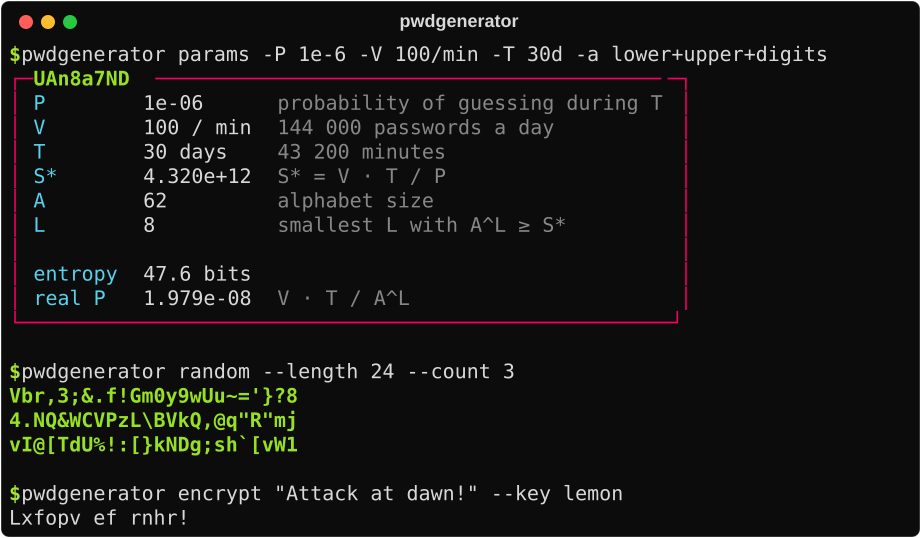

<div align="center">

# 🔐 pwdgenerator

**Password generation by Anderson's formula and by templates, plus the Vigenère cipher.**

A small Python library and command line tool built from a university course on
information security: it finds the shortest password that stays safe for a given
attack, generates it with a cryptographically secure random source and explains
the calculation.

[](https://github.com/mredwardlik/pwdgenerator/actions/workflows/tests.yml)




</div>

---

## ✨ Features

- 📐 **Anderson's formula**: the shortest password that an attacker guesses
  with a probability not higher than `P`, trying `V` passwords per minute
  during time `T`. Exact integer math, no rounding surprises
- 🧩 **Templates**: build a password position by position ("two capital
  letters, a digit, a symbol...")
- 🎲 **Secure randomness**: every character comes from Python's
  [`secrets`](https://docs.python.org/3/library/secrets.html) module
- 🔁 **Vigenère cipher** for any alphabet (English, Russian, your own). Keeps
  letter case and skips spaces and punctuation
- 💻 **CLI** with readable output, and a typed Python API with no
  dependencies besides `rich`

## 📐 How the length is chosen

Anderson's formula connects the attack and the password:

$$
S^* = \frac{V \cdot T}{P} \le S = A^L
$$

| Symbol | Meaning                                           | Example        |
| :----: | ------------------------------------------------- | -------------- |
| `P`    | allowed probability of guessing during `T`        | `1e-6`         |
| `V`    | guessing speed                                    | `100/min`      |
| `T`    | how long the attacker has                         | `30d`          |
| `A`    | alphabet size (letters + digits = 62)             | `62`           |
| `L`    | password length: the smallest `L` with `A^L ≥ S*` | `8`            |

With the values above, `S* = 100 · 43 200 / 10⁻⁶ = 4.32 · 10¹²`. Seven
characters give only `62⁷ ≈ 3.5 · 10¹²` combinations, so the generator picks
eight: `62⁸ ≈ 2.2 · 10¹⁴`.

## 🚀 Installation

```bash
pip install git+https://github.com/mredwardlik/pwdgenerator.git
```

Python 3.10 or newer. This installs the `pwdgenerator` command and the Python
package.

## 💻 Command line

```bash
# shortest safe password for an attack: P = 10⁻⁶, 100 attempts a minute, 30 days
pwdgenerator params -P 1e-6 -V 100/min -T 30d

# same, but only letters and digits, and never shorter than 12
pwdgenerator params -P 1e-6 -V 100/min -T 30d -a lower+upper+digits --min-length 12

# five random passwords, 20 characters each
pwdgenerator random --length 20 --count 5

# Vigenère cipher
pwdgenerator encrypt "Attack at dawn!" --key lemon        # Lxfopv ef rnhr!
pwdgenerator decrypt "Lxfopv ef rnhr!" --key lemon        # Attack at dawn!
pwdgenerator encrypt "Привет, мир" --key ключ --alphabet ru
echo "secret message" | pwdgenerator encrypt --key key   # text from stdin
```

| Option              | Format                                                            |
| ------------------- | ----------------------------------------------------------------- |
| `-V` speed          | `<count>/<period>`: `15/min`, `3/m`, `100/day`, `2/h`, `0.5/s`    |
| `-T` time           | number + unit, can be combined: `30m`, `12h`, `10d`, `2w`, `1w3d` |
| `-a` alphabet       | sets joined with `+`: `lower`, `upper`, `digits`, `symbols`, `ru-lower`, `ru-upper` |
| `-c` characters     | exact characters to use, for example `-c 0123456789abcdef`        |

Run `pwdgenerator <command> --help` for every option. `python -m pwdgenerator`
works too.

## 🐍 Python API

```python
from pwdgenerator import Duration, Generator, Speed, Vigenere
from pwdgenerator.alphabets import DIGITS, ENG_LOWER, ENG_UPPER, SYMBOLS

# Anderson's formula
generator = Generator(ENG_LOWER + ENG_UPPER + DIGITS, min_length=6)
password = generator.generate_by_params(
    P=1e-6,                       # probability of guessing
    V=Speed(100, per='minute'),   # attempts per minute
    T=Duration(days=30),          # attack time (a datetime.timedelta)
)
print(password)          # e.g. 'q3R0VOkR'
print(password.L)        # 8
print(password.A)        # 62
print(password.entropy)  # 47.6 bits

# a fixed length
generator.generate(16)

# templates: a list of allowed characters for every position
Generator.generate_by_templates([ENG_UPPER, ENG_UPPER, '7', DIGITS, SYMBOLS, ENG_LOWER])
# e.g. 'QF73$k'

# Vigenère
cipher = Vigenere(ENG_LOWER)
cipher.encrypt('Attack at dawn!', 'lemon')  # 'Lxfopv ef rnhr!'
cipher.decrypt('Lxfopv ef rnhr!', 'lemon')  # 'Attack at dawn!'
```

`Speed` and `Duration` also read short strings: `Speed.parse('15/min')`,
`Duration.parse('1w3d')`. Wrong input raises `ValueError` with a clear message.

## 🎓 Lab examples

The `examples/` folder has the original lab assignments (in Russian). They need
the package installed:

| File                      | Assignment                                                                  |
| ------------------------- | --------------------------------------------------------------------------- |
| `examples/example_1.py`   | 30 variants of `P`, `V`, `T`: a table of passwords from Anderson's formula |
| `examples/example_2.py`   | 28 template variants built from the user ID length                          |
| `examples/example_3.py`   | interactive Vigenère cipher with a choice of alphabet                       |

```bash
python examples/example_1.py
```

## 🗂 Project structure

```text
pwdgenerator/
├── pwdgenerator/
│   ├── generator.py   # Generator, required_length(): Anderson's formula, templates
│   ├── password.py    # Password: the result with A, L, P, V, T and entropy
│   ├── speed.py       # Speed: attempts per second / minute / hour / day / week
│   ├── duration.py    # Duration: timedelta with total_minutes, total_days ...
│   ├── vigenere.py    # Vigenere cipher
│   ├── alphabets.py   # ready-made character sets
│   └── cli.py         # command line interface
├── examples/          # lab assignments
└── tests/             # pytest
```

## 🧪 Tests

```bash
pip install -e ".[dev]"
pytest
```

Tests cover the formula (including exact powers like `S* = 10⁶`), parsing,
templates, the cipher and the CLI. Doctests in the modules run too.
